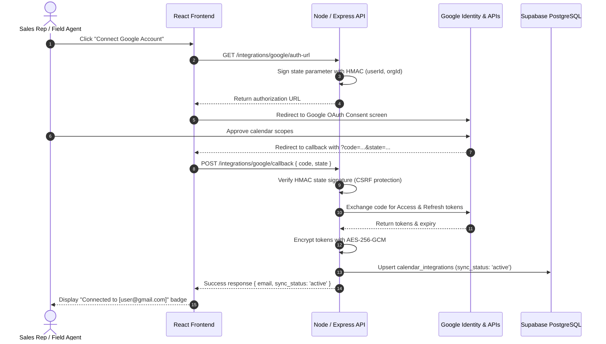

# Integrations & Communications: Google Calendar, Meet, Email & WhatsApp

## Overview
This document details the configuration, security architecture, OAuth lifecycle, event synchronization, automated reminders, and communication dispatch for Google Calendar, Google Meet, Outbound Email (SMTP), and WhatsApp in the Solar CRM.

---

## 1. Google Calendar & Google Meet Integration

### 1.1 Minimal Scopes Requested
The integration follows the principle of least privilege, requesting only:
- `https://www.googleapis.com/auth/calendar.events`: Read and write access to primary calendar events.
- `https://www.googleapis.com/auth/userinfo.email`: Read authenticated user's email address for display.
- `openid`: Standard OpenID Connect identification.

### 1.2 OAuth 2.0 Authorization Lifecycle


### 1.3 Security: AES-256-GCM Encryption at Rest
- **Encryption Algorithm**: AES-256-GCM with a random 12-byte initialization vector (IV) and a 16-byte authentication tag per encryption.
- **Key Derivation**: Configured via `INTEGRATION_ENCRYPTION_KEY` (or derived deterministically from `SUPABASE_JWT_SECRET` via SHA-256).
- **Frontend Isolation**: Neither access tokens nor refresh tokens are **ever** returned to the React frontend. The UI only receives `{ connected: true, account_email, calendar_id, sync_status }`.
- **Token Refresh**: When the access token expires (or has $< 5$ minutes of remaining validity), the server automatically decrypts the refresh token, calls Google's token endpoint, and updates the database with the freshly encrypted access token.

### 1.4 Google Meet Video Conferencing
When `create_meet_link: true` is requested:
- The API includes `conferenceDataVersion=1` and a `conferenceData.createRequest` with `conferenceSolutionKey: { type: 'hangoutsMeet' }`.
- Google provisions a unique Meet URI (`https://meet.google.com/xxx-yyyy-zzz`).
- The Meet link is saved to `calendar_events.meet_link`, appended to `lead_activities` (`activity_type: 'meeting'`), and displayed in the frontend with a 1-click **Copy Link** and **Join Meeting** button.

### 1.5 Duplicate Prevention & Cancellation
- **Duplicate Prevention**: Before creating an event, the server checks if an active `calendar_events` record already exists for the given `follow_up_id` or `site_visit_id`. If found, the existing event is returned without duplicating entries on Google Calendar.
- **Event Updates**: `PATCH /integrations/google/events/:id` updates Google Calendar and the local database.
- **Event Cancellation**: `DELETE /integrations/google/events/:id` deletes the event from Google Calendar and marks the local record `status = 'cancelled'`.

---

## 2. Automated Follow-up Reminders Schedule

The reminders engine scans active follow-ups (`status IN ('pending', 'rescheduled')`) and dispatches in-app notifications according to a strict schedule:

| Stage | Trigger Window | Notification Type | Action Required |
| :--- | :--- | :--- | :--- |
| **Due Soon** | $t_{\text{due}} - t_{\text{now}} \le 24 \text{ hours}$ | `followup_due_soon` | Early notice to plan consultation / roof survey. |
| **Due Today** | $t_{\text{due}}$ falls on today's calendar date | `followup_due_today` | Morning priority alert before close of business. |
| **Overdue** | $t_{\text{due}} < t_{\text{now}}$ | `followup_overdue` | Persistent high-priority banner until resolved. |

### Deduplication Protection
To avoid spamming users during repeated evaluations, the engine performs a lookup in `notifications` for `(user_id, type, metadata.follow_up_id)` created within the last 24 hours. If an identical reminder has already been issued, it is safely skipped (`duplicates_skipped`).

---

## 3. Email Integration

### 3.1 Delivery Architecture & Status Indicators
- **Configured vs. Unconfigured**: The system clearly distinguishes live delivery from simulated testing:
  - When `SMTP_HOST`, `SMTP_USER`, and `SMTP_PASS` are configured: Delivers via live SMTP transport (`status: 'sent'`).
  - When unconfigured: Dispatches in simulation mode (`status: 'simulated'`), allowing team members to test templates without false delivery claims.
- **Append-Only Communication History**: Every email is logged in `communication_logs` (recipient, subject, body snippet, status, provider) and appended to `lead_activities` (`activity_type: 'email'`).

### 3.2 Pre-Configured Solar Templates
1. **Consultation Follow-up**: Schedules a 15-minute introductory call to review monthly electricity bills and assess preliminary solar viability.
2. **Site Survey Confirmation**: Confirms the date, location, and roof feasibility assessment schedule with the assigned field engineer.
3. **Quotation & Proposal Ready**: Notifies the customer of their customized solar PV proposal, bifacial module specifications, and PM Surya Ghar subsidy deductions.

---

## 4. WhatsApp Customer Chat

### 4.1 Deep-Link & Consent Notice
- **Click-to-Chat URI**: Generates standardized universal links:
  $$\text{https://wa.me/} + \text{formatted\_phone} + \text{?text=} + \text{url\_encoded\_message}$$
- **E.164 Normalization**: Automatically strips non-digits and prepends the India country code (`91`) to 10-digit mobile numbers.
- **Explicit Sending Notice**: The UI displays a mandatory advisory:
  > *"Clicking 'Open WhatsApp' launches WhatsApp Web or desktop with the pre-filled template. The message is NOT sent automatically until you review and press the Send button in WhatsApp."*

### 4.2 Business Platform Cloud API (Optional)
If `WHATSAPP_API_TOKEN` and `WHATSAPP_PHONE_NUMBER_ID` are configured on the server, the system enables server-side dispatch through the official Meta Graph API (`/v19.0/{phone_number_id}/messages`).

---

## 5. Required Environment Variables

Add the following variables to `apps/api/.env`:

```bash
# ── Google OAuth 2.0 (Google Cloud Console > Credentials > OAuth 2.0 Client IDs)
GOOGLE_CLIENT_ID="your-client-id.apps.googleusercontent.com"
GOOGLE_CLIENT_SECRET="GOCSPX-your-client-secret"
GOOGLE_REDIRECT_URI="http://localhost:5173/settings/integrations/google/callback"

# ── AES-256-GCM Token Encryption at Rest
INTEGRATION_ENCRYPTION_KEY="32-character-secret-key-or-64-hex"

# ── Outbound Email (SMTP)
SMTP_HOST="smtp.sendgrid.net"
SMTP_PORT=587
SMTP_USER="apikey"
SMTP_PASS="SG.your-sendgrid-api-key"
EMAIL_FROM="solar-consultants@sunbeam.example"

# ── Optional: WhatsApp Business Cloud API
WHATSAPP_API_TOKEN="EAAG..."
WHATSAPP_PHONE_NUMBER_ID="109876543210987"
```

---

## 6. Automated Test Coverage

| Test Suite | Location | Tests | Features Verified |
| :--- | :--- | :--- | :--- |
| **API Integration** | [integrations-integration.test.ts](file:///c:/Users/tarun/OneDrive/Desktop/SAM/solar-crm/apps/api/tests/integrations-integration.test.ts) | 13 | AES-256-GCM encryption/decryption, Google OAuth state verification, calendar event creation with Google Meet, duplicate event prevention, event cancellation, account disconnect, email delivery with communication logging, WhatsApp E.164 normalization, reminder evaluation, and 24h deduplication. |
| **Web Unit** | [integrations.test.ts](file:///c:/Users/tarun/OneDrive/Desktop/SAM/solar-crm/apps/web/tests/unit/integrations.test.ts) | 5 | Client-side wa.me URL encoding, 10-digit phone validation, Google Meet URL format validation, and unconfigured provider badge state. |
| **Full Suite** | Monorepo | **132** | 100 API tests + 32 Web tests passing. |
