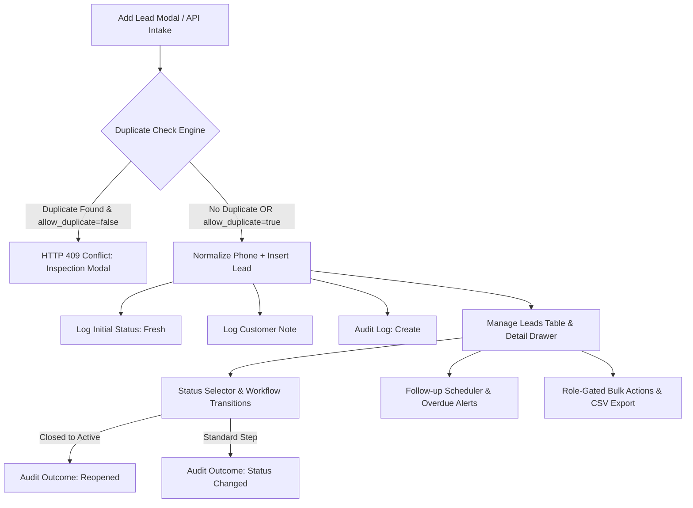

# Manage Leads Module — Architecture & Implementation Guide

The **Manage Leads** module serves as the primary CRM workflow engine in Sunbeam Solar CRM, enabling multi-user lead qualification, customer deduplication, role-scoped pipelines, and complete customer engagement history.

---

## 1. Core Capabilities & Architecture

---

## 2. Add Lead Form & Deduplication Safeguards

### Validation & Field Rules
- **Customer Name** *(required)*: Minimum 2 characters, maximum 150 characters.
- **Phone** *(required)*: Standardized to canonical format (e.g. `+91XXXXXXXXXX` for Indian 10-digit mobile numbers starting with 6–9).
- **Email** *(optional)*: Validated against RFC email regex.
- **Pincode** *(optional)*: Enforces 6-digit Indian postal code format (`^[1-9][0-9]{5}$`).
- **Enquiry Type**: Configurable (`residential`, `commercial`, `industrial`, `agricultural`, `housing_society`, `other`).
- **Lead Source**: `Meta Ads`, `Tata Solar`, `JustDial`, `Website`, `Referral`, `Cold Call`, `Other`.
- **Initial Note**: Contextual notes regarding rooftop area, 3-phase connection, monthly power consumption, or PM Surya Ghar subsidy queries.

### Duplicate Prevention Without Silent Merging
Silent merging of customer records can destroy historical quotes and corrupt sales attribution. Instead, the module implements:
1. **Real-time Blur Check**: Queries `GET /leads/check-duplicate?phone=...` upon entering phone or email.
2. **Atomic Conflict (HTTP 409)**: If a duplicate is submitted without `allow_duplicate: true`, the API rejects the insert and returns matching leads (`id`, `customer_name`, `phone`, `email`, `status`, `created_at`, `inbound_sales`).
3. **Interactive Inspection UI**: The user is presented with two explicit actions:
   - **Inspect Matching Lead**: Immediately opens the existing lead's detail drawer.
   - **Create Anyway**: Resubmits with `allow_duplicate: true` for legitimate multi-site or secondary installation enquiries.

---

## 3. Validated Lead Status Workflow & Reopened Deals

The CRM supports 13 validated statuses configured in `LEAD_STATUS_CONFIG`:

| Status Key | Display Label | Badge Styling | Description |
| :--- | :--- | :--- | :--- |
| `new` | **Fresh** | Blue badge / dot | New lead intake, pending initial outreach |
| `contacted` | **Contacted** | Cyan badge / dot | Initial touchpoint established |
| `qualified` | **Qualified** | Purple badge / dot | Electricity bill & rooftop criteria confirmed |
| `follow_up` | **Follow-up** | Indigo badge / dot | Active callback scheduled or in consultation |
| `site_visit_scheduled` | **Site Visit Scheduled** | Amber badge / dot | Field agent rooftop visit booked |
| `site_visit_completed` | **Site Visit Completed** | Yellow badge / dot | Roof measurements and orientation assessed |
| `quotation_prepared` | **Quotation Prepared** | Violet badge / dot | BOM pricing and system proposal drafted |
| `quotation_sent` | **Quotation Sent** | Pink badge / dot | Official proposal delivered to customer |
| `negotiation` | **Negotiation** | Orange badge / dot | Commercial or subsidy terms discussion |
| `won` | **Won** | Emerald badge / dot | Deal closed, contract or advance received |
| `lost` | **Lost** | Rose badge / dot | Customer declined or selected competitor |
| `not_interested` | **Not Interested** | Slate badge / dot | Customer opted out of solar installation |
| `disqualified` | **Disqualified** | Zinc badge / dot | Unsuitable roof, structural issues, or unreachable |

### Reopened Deal Handling
- When a lead in a terminal/closed state (`won`, `lost`, `not_interested`, `disqualified`) transitions back to an active stage (`new`, `contacted`, `qualified`, `follow_up`, etc.), the activity record is stamped with:
  - `outcome: 'Reopened'`
  - `notes: '[Reopened Lead] Deal reopened from "<Old Status>" to "<New Status>"'`
  - `author_id` and timestamp.

---

## 4. Manage Leads Page Features

1. **Multi-Field Search**: Searches dynamically across customer name, phone number, address, area, and pincode.
2. **Quick Filter Tabs**:
   - `All Leads`
   - `Fresh`: Status is `new`.
   - `Contacted`: Status is `contacted`.
   - `Follow-up Due`: Follow-up scheduled today or upcoming.
   - `Overdue`: Past `next_follow_up_at` and not in a closed state.
   - `Won`: Status is `won`.
   - `Lost`: Status is `lost`.
3. **Advanced Filters**: Status, Temperature (Hot, Warm, Cold), Lead Source, Enquiry Type, Pincode, Salesperson, Field Agent, and Date Range.
4. **Saved Filters**:
   - Built-in presets: *Hot & Urgent*, *Overdue Follow-ups*, *Meta Ads Fresh*.
   - Custom user presets persisted to `localStorage`.
5. **Role-Gated Bulk Actions**:
   - Multi-select row checkboxes.
   - Bulk Assign to Field Agent or Salesperson.
   - Bulk Status Update with note tracking.
   - Restricted to `admin` and `inbound_sales`.
6. **Role-Restricted CSV Export**:
   - Endpoint `GET /leads/export` generates RFC-compliant CSVs.
   - Restricted to `admin` and `inbound_sales`; field agents receive HTTP 403 Forbidden.
   - Automatically logged to `audit_logs` table.

---

## 5. Lead Detail View & Quick Actions

1. **Customer Contact Info**: One-click actions for Phone `tel:`, WhatsApp Chat `https://wa.me/...` with pre-filled solar greeting, and Email `mailto:`.
2. **Map View**: Clickable Google Maps search link when address or pincode is present.
3. **Status & Temperature Selectors**: Immediate update with audit activity logging and confirmation for deal reopening.
4. **Chronological Activity Timeline**: Shows all logged calls, notes, WhatsApp interactions, status changes, assignments, and follow-ups.
5. **Call Logger & Note Logger**: Custom modals to log duration, outcomes (`Connected`, `Callback Requested`, `No Answer`, `Wrong Number`), and notes.
6. **Follow-up Scheduler**: Pick date/time, assignee, and agenda. Updates `leads.next_follow_up_at` and triggers overdue alerts when past due.
7. **Google Calendar Action**: Generates standard Google Calendar event with customer details pre-filled.
8. **Linked Site Visits & Quotations**: Readout of roof suitability and proposal totals.

---

## 6. Testing Verification

- **15 Integration Tests** in `apps/api/tests/leads-integration.test.ts`:
  - Phone normalization to `+91`.
  - Duplicate detection (`GET /leads/check-duplicate`).
  - Duplicate rejection (HTTP 409) and override (`allow_duplicate: true`).
  - Status transitions & Reopened Deal outcome tracking.
  - Call logging & Follow-up scheduling with `next_follow_up_at` update.
  - Role-scoped bulk assignment and bulk status update.
  - CSV export authorization and 403 denial for field agents.
- **87 Total Tests Passing** across the entire monorepo.
