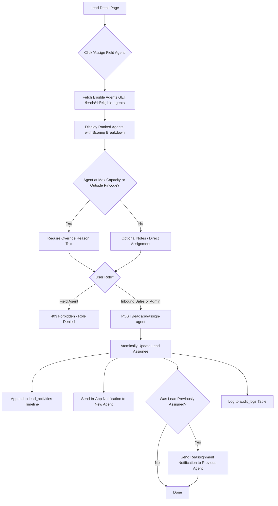

# Pincode-Based Field Agent Assignment Engine

## Overview
This document specifies the architecture, scoring algorithm, recommendation rules, authorization boundaries, and notification mechanics of the Field Agent Assignment System implemented in the Solar CRM.

---

## 1. Core Principles & Matching Philosophy

1. **Eligibility Signal vs Geographic Proximity**:
   Indian postal pincodes serve as an eligibility boundary and territorial routing signal. Pincode equality alone does not prove geographic proximity; geodesic/road distance calculations are intentionally decoupled and only applied when reliable latitude/longitude coordinates and map services are provisioned.
2. **Deterministic Recommendation**:
   When multiple field agents qualify for a lead, the system calculates a multi-factor score out of 100 points based on territorial affinity, availability, active workload headroom, and pending site visits.
3. **Override Architecture**:
   If no agent services the lead pincode, or if the best agent has exceeded their active lead capacity, an Admin or Inbound Sales user can explicitly override the recommendation by providing an auditable reason.
4. **Append-Only History & Dual Notifications**:
   Assignments and reassignments are recorded in `lead_activities` (`activity_type: 'assignment'`), preventing silent record tampering. When a lead is reassigned, notifications are dispatched to both the incoming agent (`lead_assigned`) and the outgoing agent (`lead_reassigned`).

---

## 2. Multi-Factor Scoring Rubric

The scoring function evaluates each active field agent against the lead's location, current workload, and availability:

| Factor | Criterion | Score Delta | Notes |
| :--- | :--- | :--- | :--- |
| **Service Pincode Match** | Lead pincode is in agent's `service_pincodes` | **+50 pts** | Primary territorial eligibility signal. |
| **Base Pincode Match** | Lead pincode matches agent's home base `pincode` | **+35 pts** | Local proximity bonus if service pincode is not explicitly configured. |
| **Area Match** | Lead area matches one of agent's `service_areas` (case-insensitive substring) | **+25 pts** | Sub-district / locality coverage signal. |
| **Availability: Available** | Agent `availability === 'available'` | **+20 pts** | Full readiness for assignment. |
| **Availability: Busy** | Agent `availability === 'busy'` | **+5 pts** | Agent is operational but handling high task volume. |
| **Availability: On Leave / Offline**| Agent `availability === 'on_leave'` or `'offline'` | **-50 pts** | Demotes agent to prevent missed appointments. |
| **Workload Headroom** | Ratio of free capacity: `(max_capacity - active_leads) / max_capacity * 15` | **Up to +15 pts** | Rewards agents with spare bandwidth to handle new leads quickly. |
| **Low Pending Visits** | Pending site visits: `Math.max(0, 10 - pending_visits * 2)` | **Up to +10 pts** | Distributes site survey backlog across the team. |
| **Capacity Penalty** | Active leads $\ge$ `max_active_leads` | **-30 pts** | Penalizes over-utilized agents; requires explicit override reason. |

- **Score Range**: Clamped between `0` and `100`.
- **Recommendation Flag**: The agent with the highest positive score is marked `recommended = true` with a detailed human-readable `recommendation_reason`.
- **Tie-Breaking**: If scores are equal, the agent with fewer pending site visits and lower active workload is preferred.

---

## 3. Assignment Workflow & Permission Matrix



### Authorization Rules
- **Admin**: Full authority to assign or reassign any field agent, with or without override reasons.
- **Inbound Sales**: Full authority to assign or reassign field agents for leads in their organization.
- **Field Agent**: **Strictly blocked (403 Forbidden)** from reassigning leads or modifying assignment owners.

---

## 4. API Endpoints

### 4.1 `GET /api/v1/leads/:id/eligible-agents`
Analyzes all active field agents in the organization and returns a sorted list of matches:

```json
{
  "success": true,
  "data": {
    "lead_id": "00000000-0000-0000-0000-000000000101",
    "lead_pincode": "411038",
    "lead_area": "Kothrud",
    "current_agent_id": null,
    "has_exact_pincode_match": true,
    "unassigned_reason": null,
    "agents": [
      {
        "agent_id": "00000000-0000-0000-0000-000000000021",
        "full_name": "Amit Patil",
        "phone": "+919876543201",
        "email": "amit.patil@sunbeam.example",
        "base_pincode": "411038",
        "service_pincodes": ["411038", "411052", "411004"],
        "service_areas": ["Kothrud", "Karve Nagar", "Deccan Gymkhana"],
        "availability": "available",
        "max_active_leads": 15,
        "current_active_leads": 4,
        "pending_site_visits": 1,
        "score": 97,
        "is_pincode_match": true,
        "is_base_pincode_match": true,
        "is_area_match": true,
        "is_at_capacity": false,
        "recommended": true,
        "recommendation_reason": "Direct service pincode match (411038) • Base headquarters match • Area coverage match • Fully available • Ample capacity (4/15 active leads)",
        "notes": "Certified rooftop engineer"
      }
    ]
  }
}
```

### 4.2 `POST /api/v1/leads/:id/assign-agent`
Secured mutation endpoint executing the assignment transaction.

**Request Payload**:
```json
{
  "agent_id": "00000000-0000-0000-0000-000000000021",
  "override_reason": "Customer requested senior surveyor; approved by Sales Manager."
}
```

**Capacity & Validation Rules**:
1. Target agent must be an active profile with `role: 'field_agent'` and `account_status: 'active'`. Inactive or suspended agents are rejected with `400 INACTIVE_AGENT`.
2. If `current_active_leads >= max_active_leads` and no non-empty `override_reason` is supplied, the request is rejected with `400 CAPACITY_EXCEEDED`.
3. Updates `leads.assigned_field_agent_id` and `leads.assigned_to`.
4. Dispatches in-app notifications:
   - To newly assigned agent: `title: "New Lead Assigned: <Customer>"`, `type: 'lead_assigned'`.
   - To previous agent (if reassigned): `title: "Lead Reassigned: <Customer>"`, `type: 'lead_reassigned'`.
5. Appends an immutable row to `lead_activities` with `activity_type: 'assignment'`.
6. Appends a record to `audit_logs` tracking the actor ID, entity ID, and timestamp.

---

## 5. User Interface Integration

The assignment workflow is embedded directly into the lead detail drawer:
1. **Quick Action Header**:
   - Displays `Assign Field Agent` (or `Reassign Agent` if already assigned) with a map-pin icon.
2. **Overview Tab Integration**:
   - Under the "Assigned Field Agent" card, a `Match Agent` button allows quick access.
3. **Interactive Assignment Modal ([AssignFieldAgentModal.tsx](file:///c:/Users/tarun/OneDrive/Desktop/SAM/solar-crm/apps/web/src/features/leads/components/AssignFieldAgentModal.tsx))**:
   - **Target Lead Summary**: Displays Customer Name, Phone, Target Pincode, and Locality.
   - **No Exact Match Alert**: Amber banner warns if no field agent has configured the lead's pincode, advising alternative selection or administrative override.
   - **Ranked Agent Cards**:
     - Visual radio selection with primary highlight.
     - **Recommended Match Badge**: Highlighted in emerald green for the top-scoring candidate.
     - **Match Score Pill**: Numeric score (0–100) indicating algorithmic match strength.
     - **Availability Status**: Color-coded badges for Available, Busy, On Leave, and Offline.
     - **Workload Capacity Meter**: Progress bar comparing active leads against `max_active_leads`.
     - **Territory Tags**: Badges for base pincode, configured service pincodes, and coverage areas (exact matches flagged with a checkmark).
     - **Recommendation Explanation**: Concise bullet-point summary explaining why this agent was ranked.
   - **Override Reason Input**: Dynamic textarea that activates when selecting an agent at capacity or outside service boundaries.

---

## 6. Automated Test Coverage

The assignment engine is thoroughly verified across unit, integration, and UI suites:

| Suite | File | Tests | Coverage |
| :--- | :--- | :--- | :--- |
| **API Integration** | [agent-assignment.test.ts](file:///c:/Users/tarun/OneDrive/Desktop/SAM/solar-crm/apps/api/tests/agent-assignment.test.ts) | 9 | Matching scoring calculation, ranking order, capacity limits, override validation, initial assignment, reassignment dual-notifications, append-only activity history, and role-based 403 authorization guards. |
| **Web Unit** | [assignment.test.ts](file:///c:/Users/tarun/OneDrive/Desktop/SAM/solar-crm/apps/web/tests/unit/assignment.test.ts) | 8 | UI override requirement triggers, agent ranking hierarchy, availability penalties, and client-side role permission boundaries. |
| **Full Suite** | Monorepo | **114** | Complete end-to-end regression across API (87 tests) and Frontend (27 tests). |
